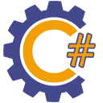
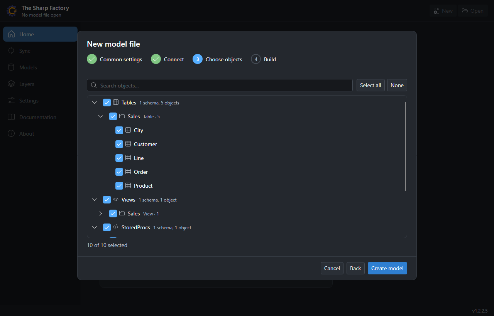
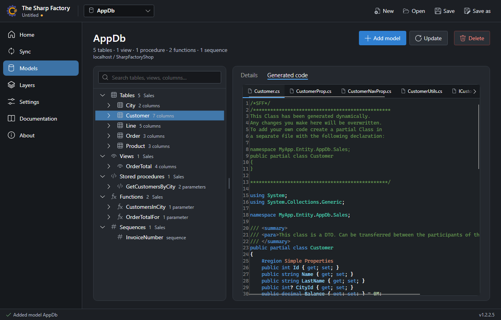
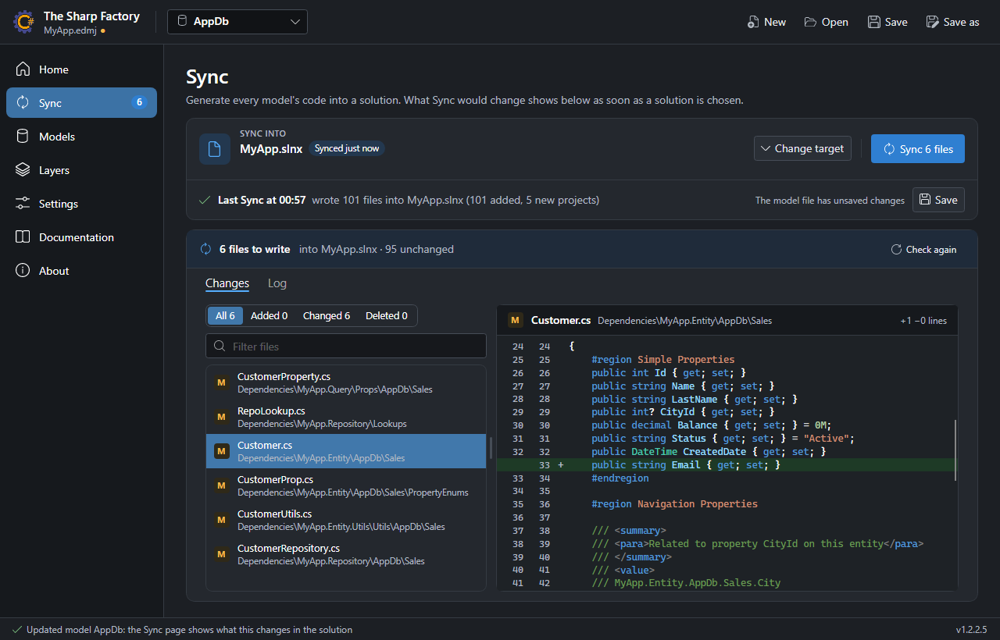

<p align="center">
  
</p>

<h1 align="center">The Sharp Factory</h1>

<p align="center">
  C# data access generated from your SQL Server database.<br>
  Free and open source, forever. For Windows, macOS and Linux.
</p>

<p align="center">
  <a href="https://github.com/TheSharpFactory/SharpFactory/releases/latest"><strong>Download</strong></a> ·
  <a href="https://www.thesharpfactory.com/QuickStart"><strong>Quick Start</strong></a> ·
  <a href="https://www.thesharpfactory.com/Documentation/GettingStarted/Walkthroughs">Walkthroughs</a> ·
  <a href="https://www.thesharpfactory.com/Documentation">Documentation</a> ·
  <a href="https://github.com/TheSharpFactory/SharpFactory/discussions">Questions</a>
</p>

The Sharp Factory is a database-first tool for SQL Server. It reverse engineers your tables, views, stored procedures,
functions and sequences into plain C# data access code in your solution: entities, repositories, typed queries
(filtering, sorting, paging, navigation properties) and a repository container. When the database changes, Update
reads it again, and Sync shows you a diff of the generated files and writes only the ones that changed.

## Try it

1. **Download** the [latest release](https://github.com/TheSharpFactory/SharpFactory/releases/latest):
   `TheSharpFactory-win-x64.zip` (or `win-arm64`), `TheSharpFactory-osx-arm64.zip` (or `osx-x64` on Intel),
   `TheSharpFactory-linux-x64.tar.gz`. Unzip it and run it: it is self-contained, so you do not need .NET to run it.
2. **Follow the [Quick Start](https://www.thesharpfactory.com/QuickStart)**: from a database to working C# code in
   five steps.
3. **No database to try it on?** The [sample database](https://www.thesharpfactory.com/Documentation/GettingStarted/SampleDatabase)
   is a script for a small shop database (customers, orders, products), the one the documentation uses.

Prefer to watch first? The [walkthroughs](https://www.thesharpfactory.com/Documentation/GettingStarted/Walkthroughs)
play the real app and code that ran against a real database, with the SQL it sent.

## A quick look

**Pick what to generate.** Connect to your database and choose the tables, views, procedures, functions and
sequences you want.



**Browse the model and the code it generates,** before anything is written to your solution.



**Sync.** Every file that would change, with a diff, then one click writes them. Here the database gained an
`Email` column, and only the files that change are written.



## The generated code in use

After Sync, a console app that references the generated Repository project reads the sample database like this:

```csharp
using MyApp.Entity.AppDb.Sales;
using MyApp.Query;
using MyApp.Repository.Common;
using MyApp.Repository.Container;

Database.RegisterModelConnectionString(RepoLookup.ModelId.AppDb,
    "Server=localhost;Database=SharpFactoryShop;Integrated Security=true;Encrypt=False");

var repo = new RepositoryContainer();

// customers with a balance over 300, the largest first
var query = new Query<CustomerProperty>()
    .BeginPredicate()
        .Where(CustomerProperty.Balance).GreaterThan(300m)
    .EndPredicate()
    .BeginSorting()
        .OrderByDescending(CustomerProperty.Balance)
    .EndSorting();

foreach (var customer in repo.AppDb.Sales.Customer.ToList(query))
{
    Console.WriteLine($"{customer.Name} {customer.LastName}: {customer.Balance}");
}
```

`MyApp` is the root namespace you choose, `AppDb` the model, `Sales` the schema and `Customer` the table. The query
is typed: a misspelled column or a value of the wrong type does not compile. It sends:

```sql
SELECT [B].[Id],[B].[Name],[B].[LastName],[B].[CityId],[B].[Balance],[B].[Status],[B].[CreatedDate] FROM [Sales].[Customer] AS [B] WHERE ([B].[Balance] > @B_Balance0) ORDER BY [B].[Balance] DESC
```

## Good to know

- **SQL Server only.**
- **Database first:** it reads your database; it does not create or migrate it.
- The generated projects target **.NET 10 or .NET 11** (you choose on the Sync page). Sync adds the one package they
  need, `Microsoft.Data.SqlClient`, to the Repository project it creates. A database with `geography` or `geometry`
  columns also needs `Microsoft.SqlServer.Types` in the Entity project.
- Files you add to the generated projects are never touched: Sync rewrites and removes only files that start with
  the Sharp Factory marker.
- Point the app at development or test databases: to discover a stored procedure's result columns it may run the
  procedure when SQL Server cannot describe it.
- Documentation: https://www.thesharpfactory.com/Documentation

## Questions, ideas and bugs

Questions and ideas are welcome in [Discussions](https://github.com/TheSharpFactory/SharpFactory/discussions), and
bugs in [Issues](https://github.com/TheSharpFactory/SharpFactory/issues).

## The app

`App/SF.App` (Avalonia). Start a **new model file**, or open an `.edmj`:

- **Models**: add a model from a database (choose the objects), update it, browse it, and preview the code
  generated for any table, view, procedure or function.
- **Layers** and **Settings**: the project names and namespaces of the generated code.
- **Sync**: generate everything into a solution. Pick one you synced this model to before, one near the model
  file, any `.sln`/`.slnx`, or a new solution (`.slnx` by default).
  As soon as a solution is chosen, the page shows every file Sync would add, change or delete, with a diff, and
  works it out again when the model changes; **Sync N files** writes them.

Sync creates the projects (in the dependencies solution folder), adds the references between them, writes only
the files whose content changed, and removes generated files the model no longer produces. Files you add to the
generated projects are never touched: only files that start with the Sharp Factory marker are.

## The command line

```
sharpfactory sync <model.edmj> <solution.sln|.slnx> [--preview]
sharpfactory generate <model.edmj> <output folder>
sharpfactory update <model.edmj> [--model <name>] [--check]
sharpfactory info <model.edmj>
sharpfactory --version
```

`update` reads each model's objects again from its database and saves the file (objects the database no longer
has drop out; new ones are not added). With `--check` it saves nothing and exits with 1 when a model would change,
so a build can tell that the model is behind the database. `--version` prints one line, such as
`sharpfactory 1.2.2.5`. Exit codes: 0 success, 1 failure, 2 usage error.

## Building

```
dotnet build SF.slnx
dotnet test Tests/SF.Tests/SF.Tests.csproj
dotnet test Tests/SF.App.Tests/SF.App.Tests.csproj
dotnet run --project App/SF.App
```

The database tests need SQL Server: `python .github/scripts/setup_test_databases.py` starts one in Docker with the
test databases (see `TESTING.md`). CI does the same on Linux, so every push runs them.

Requires the .NET 10 SDK. `TESTING.md` describes the regression checks (generated code must stay
byte-identical), `PLAN.md` the app's design, `BACKLOG.md` the open work, `RELEASE_NOTES.md` every change and
`CHANGELOG.md` what each published release brings.

## Repository

| Folder | What |
|---|---|
| `App/SF.App` | The desktop app (Avalonia) |
| `App/SF.Cli` | The command line (`sharpfactory`) |
| `Dependencies/SF.Engine` | Building models, the generation order, Sync, the Sync target list, settings |
| `Dependencies/SF.CodeGenerator`, `SF.CSharpGenerator` | The code generators |
| `Dependencies/SF.CSharpWriter` | The C# writer (`CSharpFile`) the generators write through, one file at a time |
| `Dependencies/SF.Db`, `SF.Utils`, `SF.Models` | The schema reader, the model and its `.edmj` file |
| `Tools/` | Regression tools: `SF.GenCheck`, `SF.SchemaCheck` |
| `Tests/` | Engine tests and headless UI tests |

The website, thesharpfactory.com, is a static site in its own repository, `TheSharpFactory/website` (private).

## Releases

Each release on GitHub has its notes and the downloads for Windows (x64, ARM64), Linux (x64) and macOS (x64, Apple
silicon): the app and the command line, self-contained, with `LICENSE`, `THIRD-PARTY-NOTICES.md` and a `licenses`
folder. The macOS app is not signed yet, so macOS blocks it the first time: open it once, then go to System Settings >
Privacy & Security and choose **Open Anyway**. On macOS 14 or earlier, right-click the app and choose **Open** instead.

To publish one: add the version's section to `CHANGELOG.md` (the heading `## <VERSION> — <date>`), commit, and push
the tag `v<VERSION>`. `.github/workflows/release.yml` checks that the tag matches `VERSION`, builds everything and
creates the release with that section as its text.

## License

The Sharp Factory is written by Jonathan Alfaro (JAM) and released under the [MIT License](LICENSE). It includes
third-party code and icons under their own licenses: see [THIRD-PARTY-NOTICES.md](THIRD-PARTY-NOTICES.md).

The code The Sharp Factory generates for you is yours: use it, change it and license it however you like.
